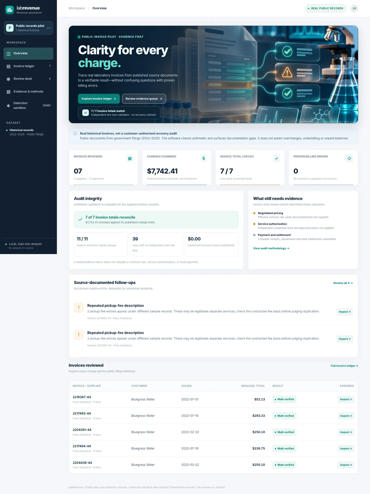
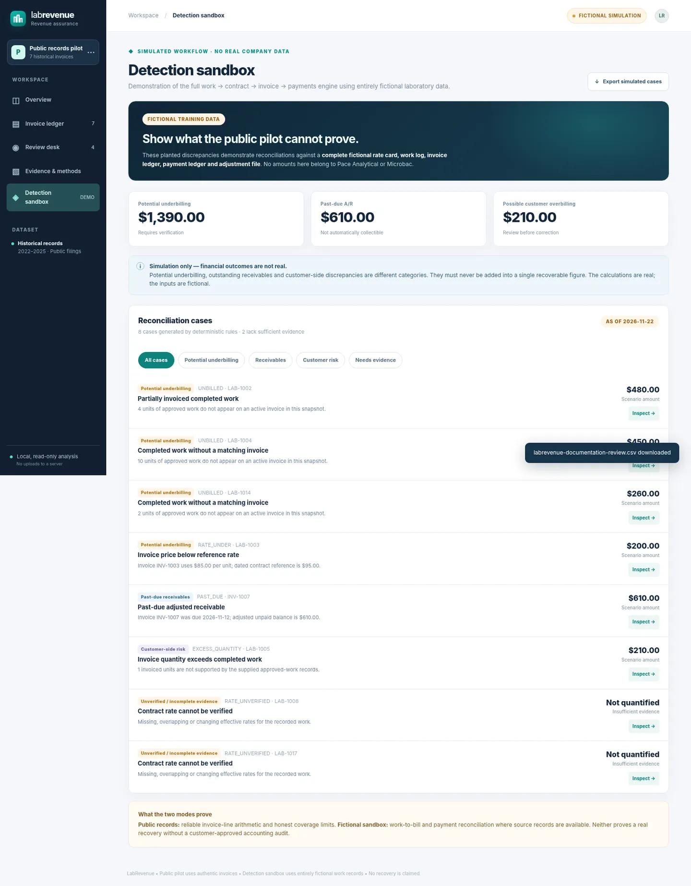

# LabRevenue Check

**An evidence-first laboratory revenue assurance prototype, with a new public-invoice pilot and a separate fictional error-detection sandbox.**



## New: public-invoice pilot

**[Open the self-contained demonstration source](public-pilot/index.html)** (download the HTML and open it in a browser; no account, server, or dependencies). The art is custom generated and embedded, with optimized assets stored in [`public-pilot/assets/`](public-pilot/assets/).



### Verified public-record outputs

| Metric | Result |
|---|---:|
| Real historical invoices | 7 (Pace Analytical: 5; Microbac: 2) |
| Published invoice lines | 50 |
| Invoice totals checked | $7,742.41 |
| Totals that match their published lines | 7/7 |
| Explicit quantity × unit-rate calculations | 11/11 pass |
| Historical documentation review topics | 4, not errors |
| Confirmed billing error or money recovered | **None established** |

This is **not** a current audit of Pace or Microbac. Source records are public government filings, manually transcribed, and do not include full executed customer contracts, independent service-work exports or complete payment allocations. We have not contacted the companies or claimed recovery.

The **fictional sandbox** deliberately includes underbilling ($1,390), past-due A/R ($610), and customer overbilling risk ($210) to demonstrate the full deterministic detection engine. **Those three figures are not real-company findings and must not be added into one recoverable total.**

### Run and test

```bash
python public-pilot/src/pilot_engine.py
python public-pilot/tests/test_pilot_engine.py
node public-pilot/tests/engine.test.js
```

The browser smoke suite is at `public-pilot/tests/browser_pilot.py` (Python Playwright + Chromium). The modular UI lives under `public-pilot/src/`; full historical outputs are in `public-pilot/src/data/` and `public-pilot/src/pilot-results.csv`.

### Public sources

- [Kentucky Public Service Commission – five Pace invoices](https://psc.ky.gov/pscecf/2022-00432/kerry.ingle%40dinslaw.com/06162023062338/Exhibit_PSC_3-20%28c%29_%28Part_4_of_6%29.pdf)
- [Plymouth Water Department – Microbac invoice and historical clarification](https://www.plymouth-ma.gov/DocumentCenter/View/7832/2025-SPECIAL-TOWN-MEETING-BOOK)
- [Del Norte Solid Waste Authority – Microbac invoice and claim voucher](https://recycledelnorte.ca.gov/dist/docs/agendas/2025/02-18-2025-Agenda.pdf)

Original development assets and the prior spreadsheet-oriented POC remain in the root code files, with earlier changes recorded in Git history. The public-record pilot is a **read-only research demonstration**, not a production financial platform or a live customer reconciliation.
