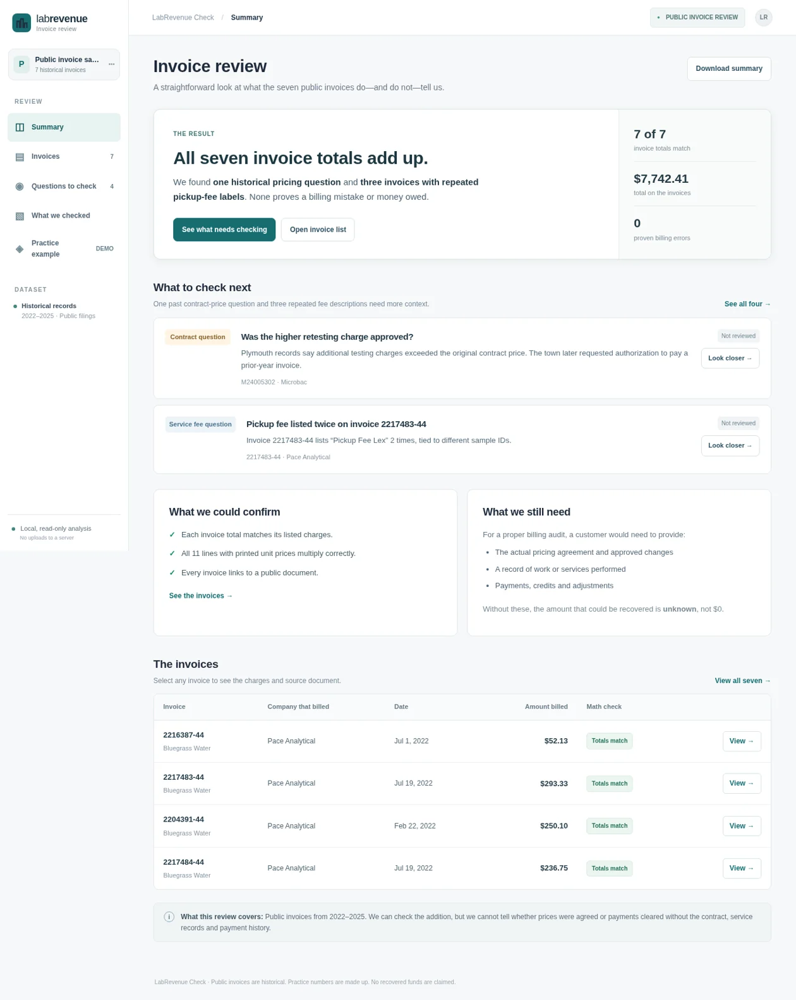
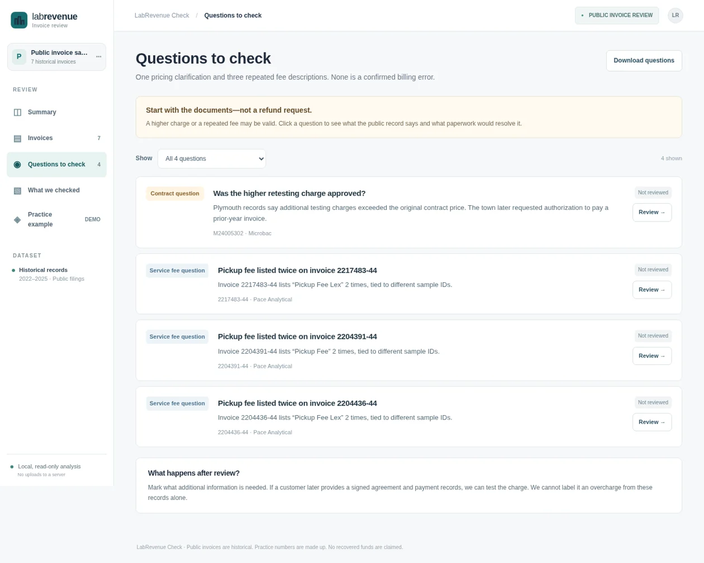

# LabRevenue Check

**An invoice-review prototype that explains what was checked, what needs attention, and what information is still missing—in plain English.**

## Open the working pilot

[**LabRevenue public-invoice pilot**](public-pilot/index.html) — download the HTML to run it locally, with no installation or server. The standalone app includes the real public-invoice review and a **separate made-up billing-error practice example**.

### Actual review results

| Question | Answer |
|---|---|
| How many real invoices were reviewed? | **7**, with 50 line items |
| How much was billed? | **$7,742.41** in the historical documents |
| Did their totals add up? | **7/7 yes** |
| Were any billing errors proven? | **No** |
| What still needs a closer look? | One historical pricing clarification and three repeated pickup-fee descriptions |
| Has any money been recovered? | **Not established** |

The practice example demonstrates fictional possible missed charges, unpaid balances and possible customer overbilling. **Its amounts do not belong to Pace Analytical or Microbac Laboratories.**

[Source files and run instructions](public-pilot/README.md) · [Human-readable sample report](public-pilot/reports/Invoice_Review_Summary.html) · [Pilot progress and public-document provenance](research/)

The illustrations in [`public-pilot/assets/`](public-pilot/assets/) are intended for promotional material, not as substitutes for real financial evidence. This is an offline, read-only proof of concept—not a live billing or recovery service.
