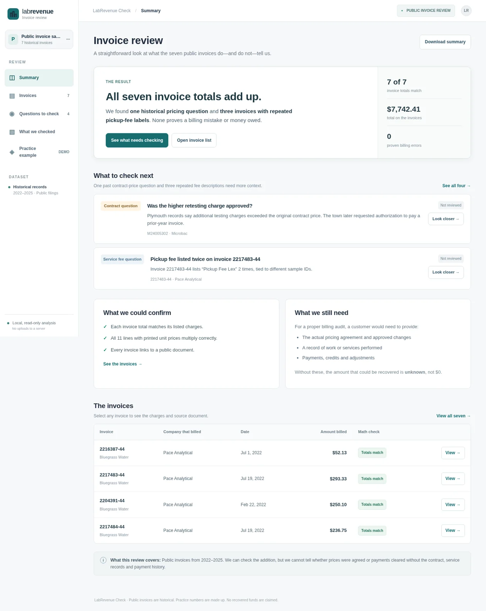
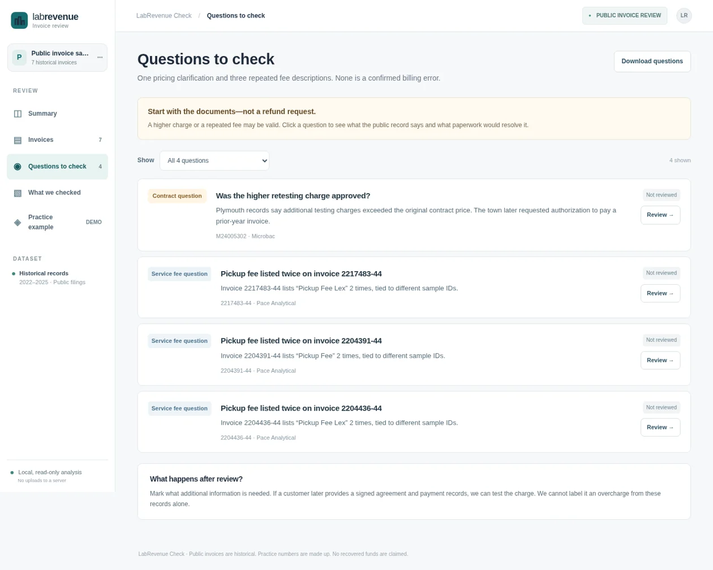
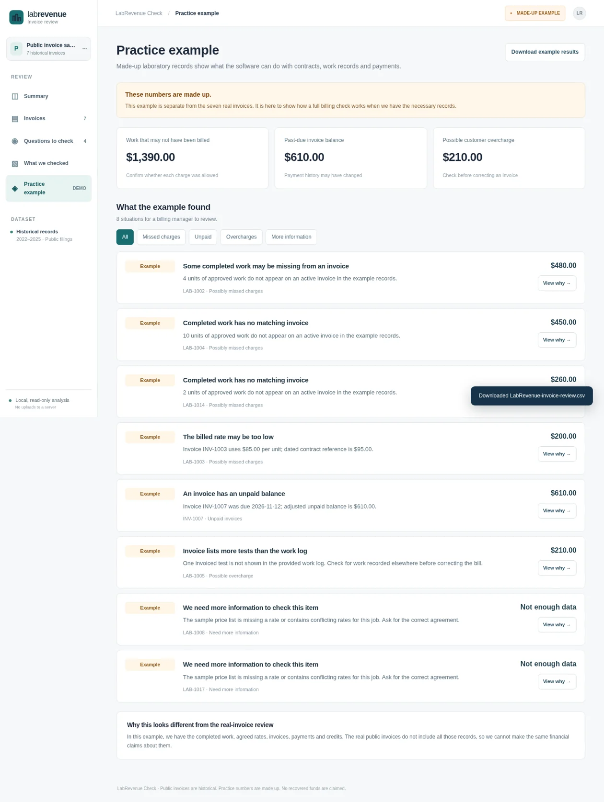

# LabRevenue Check

**See what the invoices actually tell you, what needs checking, and what document to ask for next.**



## Try it

Download [`index.html`](index.html) and open it in a browser. It runs offline and does not send files to a server.

The app has five views: **Summary**, **Invoices**, **Questions to check**, **What we checked**, and a clearly labeled **Practice example** with made-up data. Choose any invoice to see its charges and original public filing. Review questions include practical next steps and can be marked for follow-up.

## Results from seven historical public invoices

- **7 of 7** invoice totals match their listed charges.
- **11 of 11** unit-price calculations match where the original invoice shows a separate unit price.
- **$7,742.41** is the sum of the amounts printed on all seven invoices.
- **4 follow-up questions:** one historical price clarification, and three invoices with repeated pickup-fee descriptions. These are **not confirmed errors**.
- **No recoverable amount is established.** The documents do not include the full agreed prices, work performed, and payment/credit history.



## What the practice example shows

The fictional records illustrate $1,390 in possible missed charges, $610 past due, and $210 in possible overbilling. These amounts **do not belong to the real companies** and must not be combined into one recovery estimate.



## Reports

The app downloads a short, printable **plain-English invoice review summary**, plus human-readable CSV results for invoices, review questions, and practice cases. Example downloads are in [`reports/`](reports/).

## Build and test

```bash
python src/build_standalone.py
python src/pilot_engine.py
python tests/test_pilot_engine.py
node tests/engine.test.js
# Optional browser test (requires Playwright and Chromium):
python tests/browser_pilot.py
```

The `src/` directory contains the modular HTML/CSS/JavaScript and auditable Python/JavaScript reconciliation logic. No generative AI determines a financial amount.

**Sources:** [Kentucky Public Service Commission](https://psc.ky.gov/pscecf/2022-00432/kerry.ingle%40dinslaw.com/06162023062338/Exhibit_PSC_3-20%28c%29_%28Part_4_of_6%29.pdf), [Town of Plymouth](https://www.plymouth-ma.gov/DocumentCenter/View/7832/2025-SPECIAL-TOWN-MEETING-BOOK), and [Del Norte Solid Waste Authority](https://recycledelnorte.ca.gov/dist/docs/agendas/2025/02-18-2025-Agenda.pdf). Data were manually transcribed from historical public records and should be checked against original pages before an external sales presentation. We have not audited these companies' current financial records and make no allegation of wrongdoing.

Artwork remains in `assets/` for marketing use. The working financial screens deliberately avoid decorative illustrations.
